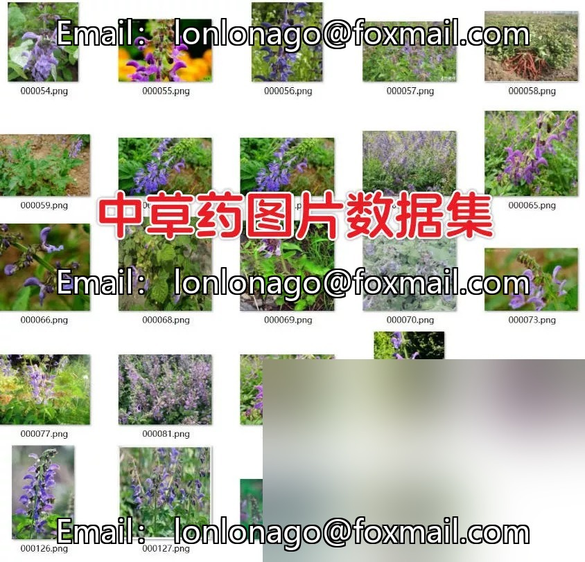

# Chinese herbal medicine image dataset, totaling approximately 67 categories and 7,000 images.

## Body

Chinese herbal medicine image dataset, totaling around 6,700 images across 70 categories

Directly applicable to model training and research
Labels are used for descriptions in Json files

web-based shipment, can be directly photographed and shipped.

The dataset consists of Chinese medicinal herbs with 67 categories and roughly 7,000 images; it can be used directly for model training and research, with labels in a JSON file and shippable via a network disk.

<!-- AI_ENRICHED -->

## Images

## Payment

Here is a pay link on Stripe ( https://buy.stripe.com/3cs8yP7sY87d0vu9AB ). Please contact me lonlonago@foxmail.com after funding $89, and I will send you a complete data files , thank you!

